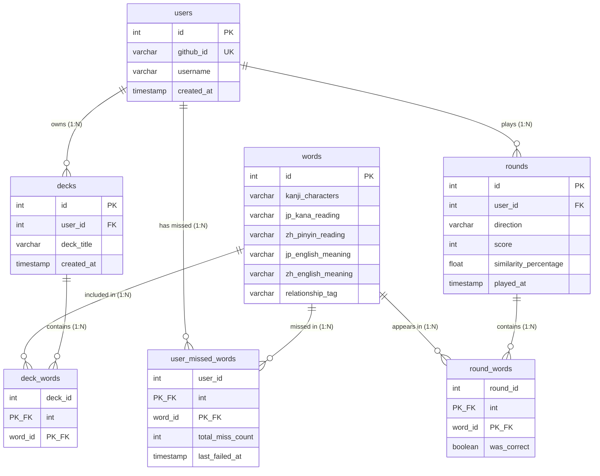

# Entity Relationship Diagram

## Tables

| Table | Purpose | Relationship(s) |
|---|---|---|
| `users` | Stores authenticated language learner profiles (GitHub OAuth) | has many `decks`, has many `user_missed_words`, has many `rounds` |
| `words` | Master word list: kanji, readings, meanings, relationship tag | has many `user_missed_words`, has many `round_words` |
| `decks` | User-created custom vocabulary collections | belongs to one `user`, has many `deck_words` |
| `deck_words` | Join table: which words belong to which deck | belongs to one `deck`, belongs to one `word` |
| `rounds` | Stores a completed quiz session (direction, score, similarity %) | belongs to one `user`, has many `round_words` |
| `round_words` | Join table: which words appeared in which round (used for similarity meter) | belongs to one `round`, belongs to one `word` |
| `user_missed_words` | Join table: tracks per-user miss counts for each word | belongs to one `user`, belongs to one `word`, has unique `total_miss_count` field |

---

## Entity Relationship Diagram

---

## Table Attribute Reference

### `users`
| Column | Type | Notes |
|---|---|---|
| `id` | integer | Primary key, auto-incremented |
| `github_id` | varchar | Unique — provided by GitHub OAuth via Passport.js |
| `username` | varchar | Display name shown on leaderboard |
| `created_at` | timestamp | Auto-set on account creation |

### `words`
| Column | Type | Notes |
|---|---|---|
| `id` | integer | Primary key, auto-incremented |
| `kanji_characters` | varchar | The shared Chinese character string shown to the player (e.g. 手紙) |
| `jp_kana_reading` | varchar | Japanese hiragana/katakana pronunciation (e.g. てがみ) |
| `zh_pinyin_reading` | varchar | Chinese pinyin pronunciation (e.g. shǒuzhǐ) |
| `jp_english_meaning` | varchar | The true English meaning of the word in Japanese |
| `zh_english_meaning` | varchar | The true English meaning of the word in Chinese |
| `relationship_tag` | varchar | `True Friend`, `False Friend`, or `Half Friend` |

### `decks`
| Column | Type | Notes |
|---|---|---|
| `id` | integer | Primary key, auto-incremented |
| `user_id` | integer | Foreign key → `users.id` |
| `deck_title` | varchar | Validated: cannot be blank (custom feature — POST/PATCH validation) |
| `created_at` | timestamp | Auto-set on deck creation |

### `deck_words` *(join table — one-to-many from each side)*
| Column | Type | Notes |
|---|---|---|
| `deck_id` | integer | Composite PK + FK → `decks.id` |
| `word_id` | integer | Composite PK + FK → `words.id` |

### `rounds`
| Column | Type | Notes |
|---|---|---|
| `id` | integer | Primary key, auto-incremented |
| `user_id` | integer | Foreign key → `users.id` |
| `direction` | varchar | `CN_TO_JP` or `JP_TO_CN` — used to filter leaderboard |
| `score` | integer | Total points earned in the round |
| `similarity_percentage` | float | % of words in the round tagged as True Friend — powers the similarity meter |
| `played_at` | timestamp | Auto-set when round is saved |

### `round_words` *(join table — many-to-many between rounds and words)*
| Column | Type | Notes |
|---|---|---|
| `round_id` | integer | Composite PK + FK → `rounds.id` |
| `word_id` | integer | Composite PK + FK → `words.id` |
| `was_correct` | boolean | Whether the player answered this word correctly — auto-generated on answer event (custom feature) |

### `user_missed_words` *(join table — many-to-many between users and words)*
| Column | Type | Notes |
|---|---|---|
| `user_id` | integer | Composite PK + FK → `users.id` |
| `word_id` | integer | Composite PK + FK → `words.id` |
| `total_miss_count` | integer | **Unique metadata field** — incremented automatically each time user misses this word (custom feature) |
| `last_failed_at` | timestamp | Updated automatically each time the user misses this word (auto-generated data custom feature) |

---

## Rubric Notes

| Rubric Requirement | How This ERD Satisfies It |
|---|---|
| `[BASELINE]` One-to-many relationship | `users` → `decks`, `users` → `rounds`, `decks` → `deck_words`, `rounds` → `round_words` |
| `[BASELINE]` Many-to-many with join table | `users` ↔ `words` via `user_missed_words`; `rounds` ↔ `words` via `round_words`; `decks` ↔ `words` via `deck_words` |
| `[CUSTOM ★]` Unique field in join table | `user_missed_words.total_miss_count` — unique per user+word pair |
| `[CUSTOM ★]` Data auto-generated on event | `round_words.was_correct` and `user_missed_words.total_miss_count` are written automatically when the player submits an answer |
| `[BASELINE]` Reset database to default state | All tables are dropped and re-seeded from the default `words` seed file |
