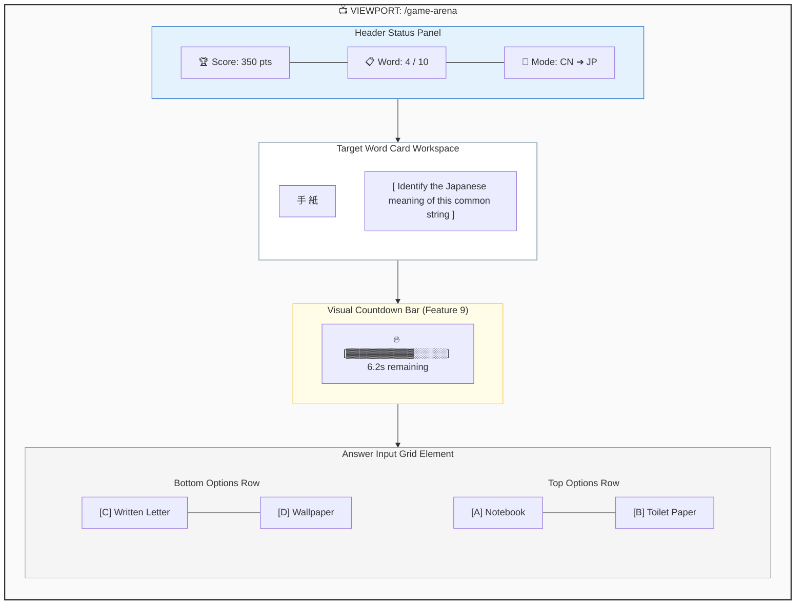
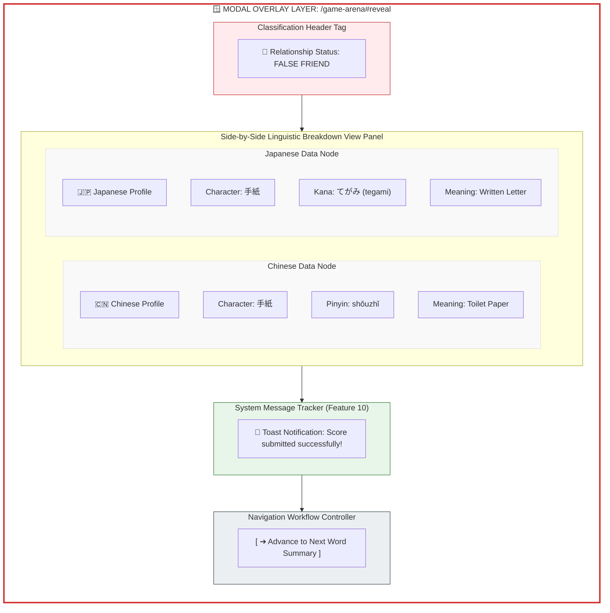
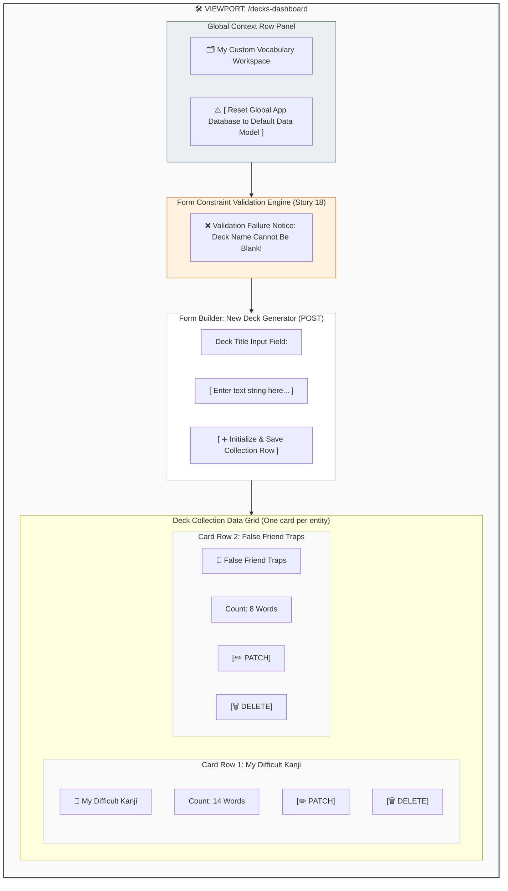

# Wireframes

This document details the interface layout and navigation mechanics for Tandem. Wireframes are rendered directly via Markdown/Mermaid block modules to preserve structural styling directly inside GitHub.

## List of Pages
* **Page 1: Landing / Game Setup Dashboard**
* **Page 2: Timed Game Loop Arena View** ⭐ (Wireframed Below)
* **Page 3: Dynamic Word Reveal Modal Overlay** ⭐ (Wireframed Below)
* **Page 4: Final Similarity Meter Dashboard**
* **Page 5: Custom Deck Management CRUD Dashboard** ⭐ (Wireframed Below)
* **Page 6: Split-Direction Leaderboard Page**
* **Page 7: User Authentication Gateway Page**

---

## Wireframe 1: Timed Game Loop Arena View (Feature 1)
* **Description:** The live gameplay layout featuring a persistent status tracking bar, a centrally isolated multi-language character display widget, a dynamic countdown progress line, and individual multiple-choice response nodes.
* **Owner:** George Liu (Stories 1, 2, 3, 4)

---

## Wireframe 2: Dynamic Word Reveal Modal Overlay (Feature 2)
* **Description:** The `[CUSTOM]` same-page modal viewport tracking a linguistic comparison framework layer on top of a grayed-out game arena canvas.
* **Owner:** Hunter Smith (Stories 5, 6, 7)

---

## Wireframe 3: Custom Deck Management CRUD Dashboard (Feature 5)
* **Description:** The authenticated user playground. Houses modular lists, deck cards, validation warnings, and creation options.
* **Owner:** Robert Cunningham (Stories 14, 15, 16, 17, 18)

